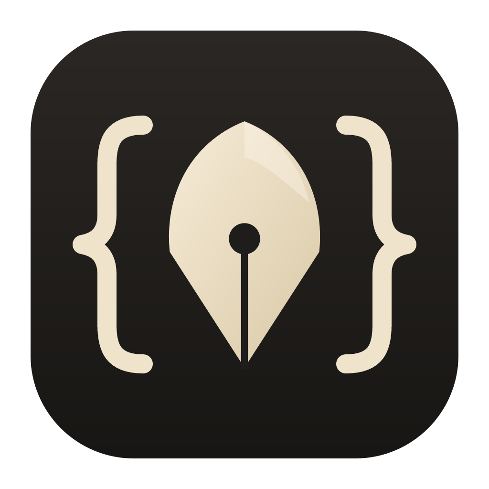

<h1 align="center">BMEditor</h1>

Batteries included editor. Free to use.

BMEditor is a desktop code editor that is ready to work as soon as it opens.
Claude Code, Docker, a debugger, a terminal and live previews for Markdown,
HTML and OpenAPI are part of the editor itself, so there is nothing to find
or set up first. Go support is built in, and other languages can be added
through extensions. The layout and keyboard shortcuts follow VS Code, which
makes it easy to feel at home.

## What comes with it

- **Claude Code** in the side panel. Its changes come in as a review, so you
  keep what you like. Select some code and press Ctrl+Alt+K to ask about it.
  If you allow it in Settings, Claude can also use the debugger and Docker.
- **A debugger** on F5, with Delve for Go. Breakpoints can have conditions or
  just log a message, and you see each variable's value right in the code.
  Other debuggers plug in too: an extension can bring gdb, and Project
  Settings can attach to something already running, like QEMU.
- **Docker** next to your code: containers by compose project, logs, a shell
  inside them, and compose up and down.
- **Previews** that follow your typing: Markdown, HTML pages, and OpenAPI or
  Swagger specs through Swagger UI.
- **Go** without setup: gopls, completion that adds the imports, errors as
  you type, rename, quick fixes, formatting on save, and run, build, test and
  vet.
- **A terminal** with copy, paste and clickable links.
- **Git, to look at**: changed lines, diffs, a list of what changed, and
  merge conflicts you resolve in the file. Committing is left to your git
  client.
- **Extensions** for other languages and tools, from a git repository, a
  folder or a zip. First-party extensions are in
  [BMEditorExtensions](https://github.com/Cn8001/BMEditorExtensions).
- **Other machines**: open a folder in WSL, on a server or VM over SSH, on
  another Windows computer, or in a Docker container, from the same window.
  There is nothing to install there.
- A **Make** menu, if your project has a Makefile.

## Five minutes to start

1. Download `bmeditor-windows-amd64.exe` from
   [Releases](https://github.com/Cn8001/BMEditor-Releases/releases) and run it.
2. Have Go and git on your PATH.
3. **New Project** (Ctrl+Shift+N), pick Go module, and you have a `main.go`.
4. Press **Ctrl+F5** to run it, or click left of a line number for a
   breakpoint and press **F5** to debug it.
5. **Ctrl+Shift+P** opens the command palette, with every command and its
   shortcut.

## Read on

| | |
|---|---|
| [The guide](docs/guide.md) | everything BMEditor does, from your first project to debugging, Claude Code, Docker, settings and shortcuts |
| [Working on another machine](docs/remote.md) | WSL, SSH hosts and containers |
| [Writing extensions](docs/extensions.md) | add a language, a debugger, settings, project templates, panels and commands |
| [Terms of use](docs/terms.md) | free to use, provided as is |
